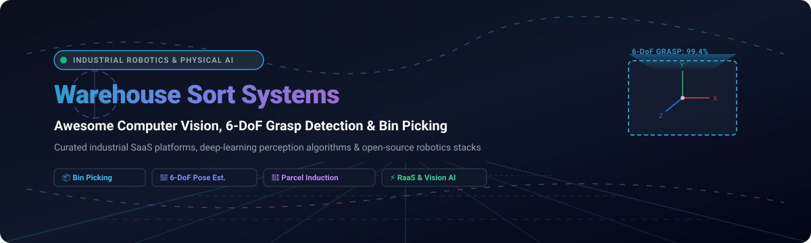

  
  
  
  
  
  

# 🏭 Awesome Computer Vision Warehouse Sort Systems 🤖📦

### *The definitive curated ecosystem of Physical AI, 6-DoF Grasp Detection, Autonomous Robotic Bin Picking & Cluttered Scene Logistics Perception.*

**Last updated: March 2026** • Maintained by [@ishandutta2007](https://github.com/ishandutta2007)

---

## 📌 Executive Overview & Core Architecture

Welcome to **Awesome Computer Vision Warehouse Sort Systems**—a comprehensive, SEO-optimized knowledge base and resource registry indexing high-throughput computer vision platforms, 6-DoF grasp pose estimation algorithms, piece-picking neural networks, and open-source robotics toolkits for modern intralogistics fulfillment.

Modern automated distribution centers rely heavily on **physical artificial intelligence (Physical AI)** to resolve complex, unstructured picking challenges:
- 🎯 **6-DoF Grasp Pose Detection**: Real-time antipodal parallel-jaw and vacuum suction point calculation across unknown items.
- 📦 **Dense Bin Picking**: Segmenting, identifying, and planning collision-free grasp trajectories in high-density, tangled tote clutter.
- 🚚 **Parcel Induction & Singulation**: High-speed identification and orientation sorting of irregular polybags, parcels, and jiffy mailers.
- 📐 **6D Pose Estimation & Sim2Real Tracking**: Foundation vision models (e.g., FoundationPose, SAM2) for novel object tracking without CAD models.
- 🔁 **Robotics-as-a-Service (RaaS)**: Subscription-based vision intelligence and human-in-the-loop exception handling (Teleoperation/HITL).

## 📑 Table of Contents

- [📊 Sector Overview & Market Dynamics](#-sector-overview--market-dynamics)
- [🏢 Enterprise SaaS & Hosted Platforms](#-enterprise-saas--hosted-platforms)
- [💻 Open-Source GitHub Projects & Perception Frameworks](#-open-source-github-projects--perception-frameworks)
- [📈 Star History](#-star-history)
- [💖 Support & Sponsorship](#-support--sponsorship)
- [🤝 How to Contribute](#-how-to-contribute)
- [⚠️ Disclaimer & Operational Safety](#️-disclaimer--operational-safety)

## 📊 Sector Overview & Market Dynamics

The global warehouse robotics and vision sortation market is estimated at **$7.7B to $10.0B** in 2025–2026, advancing at a **~14–17% CAGR** driven by acute labor availability constraints, surging SKU counts, and same-day delivery expectations.

Market dynamics exhibit a clear **dual-tier structure**:
1. 🏛️ **Concentrated Core Intralogistics**: Heavy turnkey hardware infrastructure (ASRS, shuttles, sorter loops) remains dominated by legacy warehouse automation conglomerates (e.g., KNAPP, Daifuku, Dematic, Vanderlande).
2. 🧩 **Moderately Fragmented Perception & Manipulation Layer**: The physical AI, 6-DoF grasp detection, and intelligent piece-picking arm segment is **moderately fragmented**. High-growth startups, specialized RaaS vendors, and AI research labs compete across niche fulfillment tasks like singulation, mixed-case depalletizing, and polybag induction.

## 🏢 Enterprise SaaS & Hosted Platforms

The following enterprise platforms provide proprietary computer vision software, physical AI perception, and turnkey piece-picking sortation cells under commercial licenses and RaaS contracts.

| 🏢 Platform | 💰 Company Valuation / Revenue | 🏷️ Starting Pricing Tier | ⏱️ Free Tier Limits | 🚀 Key Capabilities & Logistics Architecture |
| :--- | :--- | :--- | :--- | :--- |
| **[KNAPP Pick-it-Easy](https://www.knapp.com/)** | **€2.14B (~$2.33B)** annual turnover (FY 2025/26) | Starting at **~$8,500/month/cell** (RaaS lease & software support tier) | **30-day guided pilot evaluation** (limited to 1 simulated workstation and benchmark SKU dataset) | Turnkey robot-based piece picking workstation for high-speed logistics with AI-guided 3D vision, auto-handling diverse retail and pharma articles. |
| **[Dexterity](https://www.dexterity.ai/)** | **$1.65B** valuation ($380M+ raised; ~$66M ARR) | Starting at **~$6,000/month/robot** (RaaS model, base tier palletizing & singulation) | **30-day proof-of-concept trial** (limited to 1 physical cell test or synthetic environment digital twin simulation) | Full-stack robotic picking and mobile manipulation with dual-arm tactile sensing for unstructured environments like truck unloading and singulation. |
| **[Mujin](https://www.mujin.co.jp/en/)** | **$1.0B+** valuation ($150M+ raised; ~$116M revenue) | Starting at **~$4,500/month/controller** (Mujin Controller 3D vision & motion planning license) | **14-day simulation sandbox trial** (virtual digital twin picking environment limited to 5 test CAD models) | Real-time motion planning and 3D perception platform powering autonomous bin picking, machine tending, and depalletizing. |
| **[Covariant](https://covariant.ai/)** | **$625M** valuation ($245M raised; tech licensed by Amazon) | Starting at **~$3,500/month/station** (Covariant Brain vision software license tier) | **30-day enterprise evaluation** (benchmarked against client dataset of up to 500 SKU scans) | Universal AI robotic brain (RFM-1) for piece picking, order induction, and mixed-case sortation across varied and irregular SKUs. |
| **[Berkshire Grey](https://www.berkshiregrey.com/)** | **$375M** valuation (SoftBank acquisition; ~$51M revenue) | Starting at **~$7,500/month/system** (Robotics-as-a-Service base sortation & picking module) | **30-day operational feasibility trial** (evaluation limited to sample parcel profile analysis and warehouse workflow assessment) | Intelligent enterprise robotics for fulfillment; features AI-powered piece picking, robotic induction, and parcel sortation. |
| **[OSARO](https://www.osaro.com/)** | **~$175M** valuation ($95M raised; ~$15M ARR) | Starting at **~$2,500/month/robot** (SightWorks AI vision software license) | **30-day software pilot license** (limited to single-camera 2D/3D feed and 1,000 simulated pick cycles) | Hardware-agnostic AI perception and piece-picking software for automated bag kitting, induction, and mixed-case depalletizing. |
| **[Ambi Robotics](https://ambirobotics.com/)** | **~$150M** valuation ($67M raised; ~$12M ARR) | Starting at **~$3,000/month/cell** (AmbiSort software & system operational subscription) | **14-day warehouse throughput trial** (limited to pre-deployment simulation run on up to 250 sample packages) | AI-powered robotic sorting systems (AmbiSort) leveraging Sim2Real deep learning and suction manipulation for parcel handling. |
| **[Plus One Robotics](https://plusonerobotics.com/)** | **~$140M** valuation ($100M raised; ~$18M ARR) | Starting at **~$2,200/month/arm** (PickOne AI vision software subscription) | **30-day supervised pilot trial** (includes up to 50 hours of Yonder human-in-the-loop exception handling assistance) | 3D perception AI software for piece picking and parcel induction with Yonder cloud-based human-in-the-loop remote supervision. |
| **[Photoneo](https://www.photoneo.com/)** | **~$90M** valuation (Acquired by Zebra Technologies; ~$35M rev) | Starting at **~$490/month** (Bin Picking Studio vision & localization software license; scanner purchased separately) | **30-day fully functional trial license** (Bin Picking Studio complete features, limited to 1 workstation/dongle) | 3D vision and localization software paired with PhoXi 3D scanners and MotionCam-3D for bin-picking in cluttered environments. |
| **[Fizyr](https://www.fizyr.com/)** | **~$35M** valuation ($4M+ seed raised; ~$9M revenue) | Starting at **~$1,800/month/pick-point** (Fizyr OS deep learning vision software license) | **30-day developer evaluation trial** (limited to offline dataset inference on up to 2,000 images/point clouds) | Plug-and-play deep learning vision software for system integrators, providing real-time 6-DoF picking poses for unknown parcels and SKUs. |

## 💻 Open-Source GitHub Projects & Perception Frameworks

A ranked index of leading open-source 6-DoF grasp detectors, 6D pose trackers, synthetic training environments, and bin-picking simulators sorted descending by GitHub Stars_Count:

- **[FoundationPose](https://github.com/NVlabs/FoundationPose)** 
  🌟 Unified 6D pose estimation and tracking framework for novel and arbitrary objects from NVIDIA. Eliminates CAD model requirements at test time, providing high-precision, real-time tracking for complex warehouse picking cells.

- **[PyRender](https://github.com/mmatl/pyrender)** 
  🎨 Fast, lightweight, GPU-accelerated Python library for physically-based rendering and visualization of 3D scenes, widely used to synthesize depth and RGB-D scenes for bin-picking models.

- **[GraspNet Baseline](https://github.com/graspnet/graspnet-baseline)** 
  📐 Official baseline models and benchmark evaluation tools for the GraspNet-1Billion dataset. Standard toolset for 6-DoF robotic grasp pose generation in cluttered warehouse and tabletop environments.

- **[AnyGrasp SDK](https://github.com/graspnet/anygrasp_sdk)** 
  🦾 General object robotic grasping toolkit based on large-scale grasp models. Supports rapid 6-DoF gripper pose evaluation across arbitrary unknown geometries and dense piles in logistics setups.

- **[Open Industry Project](https://github.com/Open-Industry-Project/Open-Industry-Project-Godot)** 
  🏭 Open-source warehouse and factory automation simulator built on Godot Engine. Features full PLC industrial protocol communications (OPC UA, Modbus, Siemens S7, EtherNet/IP, UR RTDE) to simulate sorting conveyors and robotic cells.

- **[GPD (Grasp Pose Detection)](https://github.com/atenpas/gpd)** 
  🔍 Foundational open-source package for detecting 6-DoF grasp poses for 2-finger robot hands in 3D point clouds without CAD models, designed specifically to operate inside dense bin clutter.

- **[Robotic Grasping (GG-CNN)](https://github.com/skumra/robotic-grasping)** 
  ⚡ Generative Grasping Convolutional Neural Network (GG-CNN) predicting pixel-wise antipodal grasp quality, angle, and width from depth images in real time (~50 Hz) for closed-loop dynamic sorting.

- **[Contact-GraspNet](https://github.com/NVlabs/contact_graspnet)** 
  🎯 NVIDIA PyTorch implementation of Contact-GraspNet for end-to-end 6-DoF grasp generation from single or multi-view point clouds based on grasp contact point probability.

- **[Robotic Grasping Papers](https://github.com/rhett-chen/Robotic-grasping-papers)** 
  📚 Curated taxonomy and literature collection on robotic grasping, 6-DoF pose detection, tactile sensing, and reinforcement learning for warehouse manipulation.

- **[Dex-Net](https://github.com/BerkeleyAutomation/dex-net)** 
  🤖 UC Berkeley's Dexterity Network codebase for generating massive synthetic grasp datasets, computing 3D analytic grasp metrics, and training robust grasp quality convolutional networks (GQ-CNN).

- **[GQ-CNN (Grasp Quality CNN)](https://github.com/BerkeleyAutomation/gqcnn)** 
  👁️ Package for training and deploying Grasp Quality Convolutional Neural Networks on depth images for parallel-jaw grippers and suction cups in high-throughput bin-picking.

- **[FoundationPoseROS2](https://github.com/ammar-n-abbas/FoundationPoseROS2)** 
  🔄 ROS2 production-ready integration combining Segment Anything 2 (SAM2) and FoundationPose for real-time 6D object pose tracking with Intel RealSense cameras in sorting cells.

- **[GraspNeRF](https://github.com/PKU-EPIC/GraspNeRF)** 
  🌐 Multiview-based 6-DoF grasp detection using generalizable Neural Radiance Fields (NeRF), resolving grasp prediction for challenging transparent and specular items where standard depth sensors fail (ICRA 2023).

- **[SceneNet](https://github.com/ankurhanda/SceneNet)** 
  🏙️ Repository and tools for generating photo-realistic synthetic indoor scenes, trajectory data, and depth maps used in training robotic perception and cluttered bin understanding algorithms.

- **[SYN-PBOX](https://github.com/ccteaher/projects-SYN-PBOX)** 
  📦 Benchmark dataset and YOLOv8-D dual-stream vision network for robotic bin-picking of box-shaped objects (15,000 synthetic annotated images achieving >95% zero-shot real picking transfer).

- **[UR10e 3D Vision-Guided Bin Picking](https://github.com/SurabhiGupta17/UR10e-3D-Vision-Guided-Bin-Picking)** 
  🦾 Autonomous bin-picking reference stack for Universal Robots UR10e using ROS2 Jazzy, Gazebo Harmonic, MoveIt motion planning, and RealSense D435 camera point clouds.

- **[Isaac Sim Logistics Sorting Robot](https://github.com/Hazzzard-LYX/Isaacsim-logistics-sorting-robot)** 
  🚀 End-to-end simulation environment in NVIDIA Isaac Sim for logistics sorting: LiDAR localization, A* path navigation, pick-action, bank sortation, and container offloading.

- **[GraphGrasp](https://github.com/BIT-robot-group/GraphGrasp)** 
  📊 Graph-guided 6-DoF grasp pose estimation network (AAAI 2026) achieving SOTA accuracy with ~1/5 the model parameters via hierarchical graph transformers modeling spatial relationships.

- **[GraspFast](https://github.com/upc-ghy/Franka-GraspFast)** 
  ⚡ Multi-stage lightweight 6-DoF grasp pose detector running at ~42 FPS on GPU for cluttered bins, deployed on Franka Emika robotic arms (Pattern Recognition, 2025).

🛠️ **Frameworks for building custom systems**: Combine **FoundationPose** or **FoundationPoseROS2** for novel object pose tracking, **GPD**, **Contact-GraspNet**, or **GraspFast** for 6-DoF grasp detection, **GraphGrasp** for lightweight inference, **Open Industry Project** or **Isaac Sim** for simulation, and **GQ-CNN** for grasp verification—creating a fully self-hosted, enterprise-grade warehouse sortation system.

## 📈 Star History

## 💖 Support & Sponsorship

Thank you for exploring and utilizing the **Awesome Computer Vision Warehouse Sort Systems** repository! Building and curating high-signal resources for robotics engineers, warehouse automation specialists, and physical AI researchers requires continuous effort and maintenance.

If you find this repository valuable, please consider supporting the project:
- ⭐ **Star this repository** to help others in the robotics and logistics community discover it.
- 🍴 **Fork and contribute** by submitting PRs for newly published models or production platforms.
- 📢 **Share with colleagues** in your warehouse engineering or computer vision networks.
- ☕ **Buy a coffee & sponsor**: Support ongoing research, indexing, and curation via the [GitHub Sponsor Dashboard](https://github.com/sponsors/ishandutta2007).

  

## 🤝 How to Contribute

Contributions to expand and update the ecosystem are warmly welcomed!

1. 🍴 Fork this repository.
2. ✍️ Add or edit entries in `README.md` following the established table or badge list format.
3. 📝 Include platform/project name, links, concise architectural descriptions, and verifiable pricing/star benchmarks.
4. 🚀 Submit a Pull Request with a clear rationale.

## ⚠️ Disclaimer & Operational Safety

- 🛡️ This repository is a **community-curated index** for informational and educational purposes—not an explicit commercial endorsement.
- ⚠️ **Physical Safety & Compliance**: Autonomous robotic arms and high-speed sortation machinery operate around heavy loads and humans. Deployments must strictly adhere to industrial safety standards (ISO 10218, ISO/TS 15066, ANSI/RIA R15.06).
- 🔬 **Sim-to-Real Verification**: While synthetic models (SYN-PBOX, FoundationPose) demonstrate >95% zero-shot real grasp success, camera noise, lighting variation, packaging deformation, and slip dynamics necessitate rigorous hardware-in-the-loop validation before volume distribution.
- 🔐 **Security & Maintenance**: Self-hosted vision stacks and PLC networks (OPC UA, Modbus) require operational technology (OT) network isolation, routine intrinsic/extrinsic camera recalibration, and continuous model updating.

---

**Crafted with ❤️ for robotics engineers, warehouse automation architects, and computer vision developers.**

*Let's make Computer Vision Warehouse Sort Systems transparent, data-driven, and graspable.*

